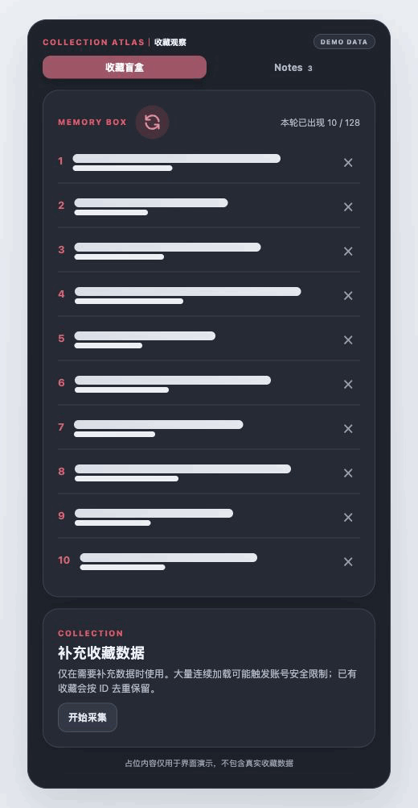

# Collection Atlas | Xiaohongshu Collection Box

[简体中文](README.md) | English

A Chrome side-panel extension for rediscovering old Xiaohongshu favorites. It randomly presents up to ten items from a locally built collection index, then lets you save text highlights and personal Notes while reading the original post.

<p align="center">
  
</p>

<p align="center"><sub>Placeholder content only. No personal collection data is shown.</sub></p>

Current version: **0.7.3**  
Runtime: **Chrome 114+**  
Interface language: **Simplified Chinese**  

> [!WARNING]
> This project is intended only for learning and personal data management. Automated indexing, scrolling, or other activity on a platform account may trigger rate limits, security verification, feature restrictions, or account suspension. Follow the platform's rules, process only data you are authorized to access, and use the extension at your own risk. To the extent permitted by applicable law, the author is not liable for account penalties, restricted functionality, data loss, or other related losses.

## Why this exists

Once a collection becomes large, organizing every item can turn into another obligation. Collection Atlas does not require you to classify thousands of saved posts first. Instead, it surfaces a small random batch at a time: open what looks useful, keep a highlight or Note, and remove irrelevant items from the local collection box.

The extension does not include AI classification, daily goals, completion rates, or streak reminders.

## Features

- **Collection box:** Randomly shows up to ten titles per batch. Items do not repeat within the same cycle, and you can reshuffle after every item has appeared.
- **Original-post reading:** Reuses one reader tab when you open different titles instead of creating a new tab every time.
- **Local organization:** The `×` button removes an item only from the extension's local random pool. It does not unfavorite the post on Xiaohongshu, and accidental removals can be restored.
- **Highlights and Notes:** Save a highlight from selectable text in an original post, then click the highlight to add or edit a Note. You can also write a Note for the whole post.
- **Data backup:** Export Notes as Markdown, or use a complete JSON backup to restore the collection index, collection-box progress, and Notes.
- **On-demand indexing:** Start assisted indexing manually from your own favorites page. You can stop at any time; duplicate post IDs are ignored and progress already collected is preserved.

## Installation

1. Download the ZIP from GitHub Releases and extract it completely.
2. Open `chrome://extensions` in Chrome.
3. Enable **Developer mode** in the top-right corner.
4. Click **Load unpacked**.
5. Select the extracted `xhs-collection-box` folder. Do not select the ZIP itself.
6. Pin the coral collection-box icon to the Chrome toolbar if desired.

See Chrome's official [Load an unpacked extension](https://developer.chrome.com/docs/extensions/get-started/tutorial/hello-world#load-unpacked) guide for more details.

## Getting started

### 1. Build the collection index

Sign in to Xiaohongshu on the web, open **your profile → Favorites**, and click **Start indexing** in the side panel's collection-data section. Keep the favorites page open while indexing runs.

You do not need to scan the entire collection before trying the extension. Stopping preserves the items already read, and later runs deduplicate records by post ID.

To reduce sustained automated activity, one batch reads approximately 500 items or scrolls 100 times at most, with a slower interval between scrolls. Reaching the limit preserves all progress and starts a five-minute cooldown. The extension stops immediately when it detects an expired login, a security-verification prompt, or an access warning. A detected security warning starts a cooldown of at least 30 minutes.

> [!CAUTION]
> Continuously loading a large favorites collection may trigger Xiaohongshu account-safety restrictions. This extension cannot guarantee that large indexing runs will avoid platform risk controls. Stop immediately if the page displays an abnormal-access or verification warning.

### 2. Open the collection box

Click the refresh icon to draw another random batch. Items already shown will not appear again in the same cycle. `N / M shown this cycle` means that the title entered the collection box, not that you finished reading it.

Click a title to open the original post. The `×` button affects only the extension's local random pool and does not change the post's favorite status on Xiaohongshu.

### 3. Save highlights and Notes

Select supported body text in an original post, then click **Note** in the floating action to save the highlight. Click a saved highlight later to add or edit your own Note. Text inside images and comments is not currently supported; use a whole-post Note instead.

## Data and privacy

The collection index, collection-box progress, locally removed records, highlights, and Notes are stored in `chrome.storage.local` for the current Chrome profile. The extension has no cloud sync, telemetry, advertising, or third-party AI requests.

- Data does not automatically follow you to another computer or Chrome profile.
- Removing the extension clears its local data.
- Export a complete JSON backup before updating or reinstalling.
- The current version removes `xsec_token` and `xsec_source` from post URLs when exporting JSON or Markdown. Backups still contain private favorites, excerpts, and Notes; do not commit them to a public repository or share them casually.
- See [PRIVACY.md](PRIVACY.md) for the complete data-handling statement.

## Permissions

| Permission | Purpose |
| --- | --- |
| `sidePanel` | Displays the collection box and Notes in Chrome's side panel. |
| `storage` | Saves the collection index, collection-box state, and Notes locally. |
| `tabs` | Opens or reuses a Xiaohongshu reader tab. |
| `scripting` | Injects the indexing scripts into the current Xiaohongshu page after the user starts indexing. |
| `activeTab` | Identifies the Xiaohongshu tab currently selected by the user. |
| `https://www.xiaohongshu.com/*` | Reads favorites already loaded on the user's favorites page and provides highlighting on post pages. |

## Known limitations

- Xiaohongshu's web favorites list does not currently provide a reliable per-item favorite date, so the extension does not display a historical favorites calendar.
- Indexing depends on the open favorites page loading normally. It cannot instantly read the entire collection in the background without the page.
- Unfavoriting a post on Xiaohongshu does not automatically remove its record from the local index.
- Comments and text inside images cannot currently be highlighted.
- Changes to Xiaohongshu's page structure may require updates to indexing and highlighting selectors.
- `chrome.storage.local` has a default capacity limit. Back up periodically if you have a large collection or many Notes.

## Updating

For a Developer mode installation:

1. Export a complete JSON backup.
2. Replace the files in the existing extension folder while keeping the same folder path.
3. Open `chrome://extensions` and click the refresh button on the extension card.
4. Refresh any Xiaohongshu pages that were already open so the content scripts update.

Do not remove the old extension before updating, or Chrome may delete its local data.

## Development

This is a Chrome Manifest V3 extension with no build step:

```text
manifest.json          Extension manifest and permissions
sidepanel.*            Collection box, Notes, and indexing interface
content-script.js      Favorites-page DOM reading and assisted scrolling
probe-main.js          Observes favorites-list responses produced by the page
annotation-script.js   Text highlighting and the floating Note interface
service-worker.js      Background persistence, status, and messaging
assets/                Extension icons
```

Run the basic checks with Node.js 18 or later:

```bash
npm run check
```

See [docs/TESTING.md](docs/TESTING.md) for the complete manual regression checklist and [docs/ARCHITECTURE.md](docs/ARCHITECTURE.md) for architecture and data flow.


## License

This project is available under the [MIT License](LICENSE).

## Disclaimer

This is an independent personal-assistance project. Follow the platform's rules and process only data you are authorized to access. Changes to the website, platform restrictions, or account-safety policies may affect how the extension works. See the warning at the top of this document for the applicable usage risks.
